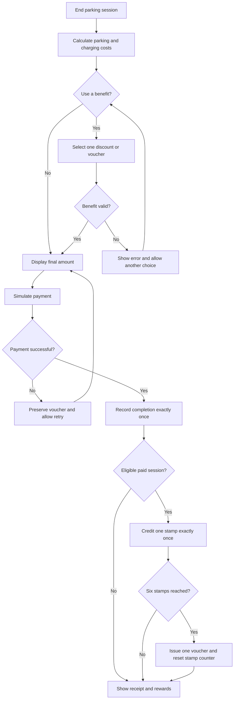

# ParkPulse — Process Diagrams

## Payment and rewards

## Notes
- Availability and payments are simulated.
- A free-parking reward session does not earn another stamp.
- Repeated confirmation must not duplicate rewards.
